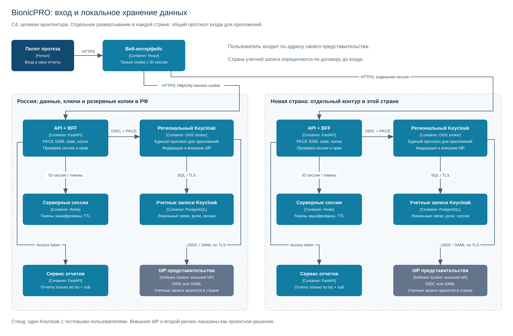
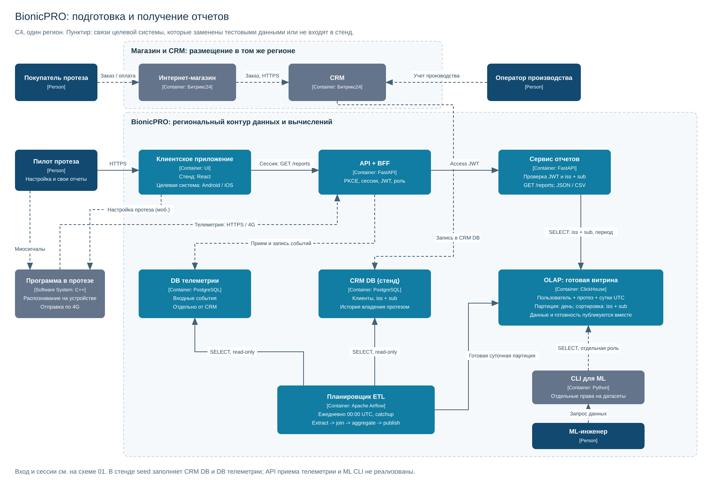

# Архитектурное решение BionicPRO

## Что меняется

Нужно защитить вход, закрыть доступ к чужим данным и добавить отчеты о работе протезов. Для входа используется Authorization Code с PKCE и серверной сессией. Отчеты строятся заранее в ClickHouse, поэтому их скачивание не нагружает CRM и базу телеметрии.

Точный способ взлома в условии не указан. PKCE защищает обмен кода авторизации, а проверка владельца отчета закрывает отдельную проблему доступа к чужим объектам. Для решения нужны обе проверки.

В репозитории реализованы Python API/BFF, отдельный сервис отчетов, Airflow DAG, витрина ClickHouse и React UI. CRM и DB представлены двумя PostgreSQL с вымышленными данными. Исходное приложение настройки протеза и его прошивка показаны на схеме, но в этом репозитории не разрабатываются.

## Задание 1. Вход и учетные записи

### Размещение по странам

[Схема draw.io](diagrams/01-identity.drawio)

В каждой стране размещаются отдельные Keycloak, PostgreSQL учетных записей, API/BFF, Redis сессий и прикладные БД. Резервные копии, журналы, ключи шифрования и временные выгрузки также остаются в этой стране. Одного разделения на realm недостаточно, если сам сервер и его БД находятся за рубежом.

Региональный Keycloak обращается к местной удостоверяющей службе через OIDC или SAML. Приложения работают с одинаковым интерфейсом OIDC, независимо от того, какой IdP выбран представительством. Если учетные записи хранятся в LDAP/AD, вместо брокера IdP можно использовать Keycloak User Federation по TLS, с доступом только на чтение. Отключение импорта LDAP-пользователей не отменяет локального хранения служебных связей и сессий в Keycloak.

Пользователь входит по адресу своего представительства. Страна учетной записи определяется по договору до авторизации. Переезд или поездка пользователя не запускает автоматический перенос его данных в другой регион.

В CRM клиент связан с парой `issuer + subject` регионального Keycloak. Email и ФИО не используются для проверки владельца. При подключении внешнего IdP сохраняется привязка к стабильному `sub` Keycloak. Объединять учетные записи по одному совпавшему email нельзя; связь с клиентом CRM должна подтверждаться при регистрации.

Схема описывает размещение для выхода в другие страны. В локальном стенде работает один Keycloak с тестовыми пользователями. Зарубежный сервер, внешние IdP и LDAP не подключены. До запуска в конкретной стране нужно определить допустимые места хранения, сроки удаления и правила передачи данных между представительствами.

### PKCE и серверная сессия

API выполняет роль BFF и обслуживает браузер на том же origin, что и React. Токены Keycloak не передаются JavaScript-коду.

1. React открывает `/auth/login`.
2. BFF создает случайные `state`, `nonce` и `code_verifier`. Из verifier вычисляется `BASE64URL(SHA256(code_verifier))`.
3. Параметры входа сохраняются в Redis на пять минут в зашифрованном виде. Отдельная HttpOnly cookie связывает этот вход с браузером.
4. Keycloak получает `code_challenge` и `code_challenge_method=S256`. Для клиента `reports-frontend` S256 обязателен, implicit flow и password grant отключены.
5. На `/auth/callback` BFF сравнивает state с cookie и атомарно удаляет запись входа. Повторный callback с тем же state отклоняется.
6. BFF обменивает код с передачей verifier, client secret и разрешенного redirect URI. Проверяются подпись, issuer, audience, тип токена, `azp`, срок действия и nonce. Subject в ID- и access-токенах должен совпасть.
7. Браузер получает случайный ID сессии в HttpOnly cookie. Access- и refresh-токены хранятся только в зашифрованной записи Redis. При повторном входе старый ID сессии удаляется.
8. Перед истечением access-токена BFF обновляет его. Redis-lock не дает параллельным запросам одновременно использовать один refresh-токен. В Keycloak включена ротация с `refreshTokenMaxReuse=0`.

Access-токен действует две минуты. Сессия ограничена одним часом; обновление токена не меняет ее конечный срок. Для HTTPS используется cookie с `Secure`, `HttpOnly`, `SameSite=Lax`, `Path=/` и префиксом `__Host-`. В локальной HTTP-конфигурации `Secure` отключен.

Клиент `reports-frontend` теперь confidential: его секрет известен BFF. `keycloak-js` удален из React, потому что этот адаптер получает токены в браузере. Фронтенд запускает PKCE-вход через BFF, а обмен кода выполняется сервером. Сам Authorization Code при этом сохраняется: PKCE дополняет этот поток проверкой verifier.

В realm явно настроен `oidc-sub-mapper`. Он добавляет `sub` в access-токен при отключенных стандартных client scopes. API отклоняет токен без `sub`. [Документация Subject mapper](https://www.keycloak.org/admin-api/protocol-mappers).

Выход проверяет Origin и CSRF-токен, затем удаляет сессию под той же блокировкой, что используется при refresh. Для этого не требуется действующий access-токен или ответ Keycloak. После удаления BFF отправляет запрос завершения SSO-сессии в Keycloak. Если IdP недоступен, локальная сессия все равно закрывается; завершение SSO на стороне IdP зависит от его доступности.

Ответы сессии и отчетов содержат `Cache-Control: no-store`. Коды авторизации не пишутся в access log. CSP разрешает скрипты только со своего origin. При добавлении других изменяющих состояние эндпоинтов для них также нужна CSRF-проверка.

### Доступ к отчетам

API проверяет сессию, JWT и роль, затем передает access-токен внутреннему сервису отчетов. Сервис повторно проверяет подпись RS256, issuer, audience `reports-api`, `azp=reports-frontend`, тип `Bearer` и обязательные `exp`, `iat`, `iss`, `sub`, `aud`. Адрес JWKS задан в конфигурации сервиса.

Роль `prothetic_user` сохранена с исходным написанием. Она разрешает обращаться к отчетам. Владелец данных определяется отдельно: SQL фильтрует строки по `iss` и `sub` из проверенного токена. Идентификатор пользователя из запроса не принимается. Сама по себе роль `administrator` доступа к отчетам не дает.

## Задание 2. Подготовка отчетов

### Схема и источники

[Схема draw.io](diagrams/02-reporting.drawio)

Сплошные связи отчетности соответствуют коду стенда. Пунктиром показаны магазин, CRM, прием телеметрии, настройка протеза и доступ ML-инженера, которые относятся к исходной или целевой системе. В стенде источники заполняет `scripts/seed.py`; API приема телеметрии и ML CLI не реализованы.

На схеме сохранены передача миосигналов и локальная настройка протеза. Распознавание движения остается на чипе и не обращается к сервису отчетов. Новые отчеты не входят в контур управления с целевым откликом до 100 мс.

CRM и телеметрия хранятся в разных PostgreSQL. ETL читает их под отдельными учетными записями с правом SELECT. Для рабочей CRM предполагается согласованный экспорт или read replica; в стенде используется отдельная БД с минимальным контрактом:

- `customers`: ID клиента, issuer и subject;
- `device_ownership`: устройство, клиент, модель и интервал владения `[valid_from, valid_to)`;
- `telemetry`: уникальный ID события, устройство, время UTC, отклик, заряд и признак движения.

Ограничение PostgreSQL запрещает пересекающиеся интервалы владения одним устройством. Событие на границе интервалов относится к новому владельцу. Первичный ключ `event_id` исключает повтор одного события. Индекс по времени позволяет читать телеметрию за отдельные сутки.

В витрину не переносятся ФИО, телефон и адрес. Связь с учетной записью и данные о работе протеза остаются чувствительными, поэтому ClickHouse размещается в том же регионе.

### Расписание и ETL

DAG `bionicpro_daily_reports` запускается в 00:00 UTC за завершенные сутки `[data_interval_start, data_interval_end)`. Начальная дата фиксируется в `.env`. `catchup=True` обрабатывает пропущенные дни, `max_active_runs=1` ограничивает DAG одним активным запуском. При ошибке предусмотрены два повтора с интервалом в минуту.

В одной Python-задаче выполняются пять этапов:

1. Создаются временные таблицы ClickHouse с уникальными именами запуска.
2. Из CRM читается история владения за нужный день, из DB - события этого дня. Каждый источник читается в своей транзакции `REPEATABLE READ`, серверным курсором по 5000 строк. Соединения закрываются после чтения.
3. События соединяются с CRM по устройству и времени владения. Каждое событие должно соответствовать ровно одному владельцу. Неизвестное устройство или неоднозначная связь останавливают загрузку.
4. ClickHouse считает суточные показатели по клиенту и протезу. Сумма счетчиков сверяется с числом извлеченных событий. В ту же партицию добавляется маркер готовности дня `row_kind='coverage'`.
5. `REPLACE PARTITION` заменяет готовую суточную партицию вместе с маркером. Временные таблицы удаляются.

Пустой завершенный день тоже получает маркер. При ошибке до публикации прежняя партиция остается доступной. Повтор заменяет весь день, поэтому счетчики не удваиваются. Данные через XCom не передаются.

Источники читаются в отдельных транзакциях, без общего снимка между БД. При несовпадении истории владения и событий проверка останавливает публикацию. После исправления источника день нужно обработать повторно. Так же учитываются поздние события: в этой версии они попадают в отчет после повторного запуска соответствующего дня. Автоматическое окно перерасчета прошлых дней пока не задано.

После аварийного завершения процесса могут остаться временные таблицы. В рабочем окружении потребуется их удаление по возрасту с проверкой, что они не принадлежат текущему запуску.

### Структура витрины

Таблица `bionicpro.daily_reports` содержит:

| Поля | Назначение |
| --- | --- |
| `region`, `row_kind`, `report_date` | Регион, тип строки и день UTC |
| `idp_issuer`, `subject`, `customer_id` | Владелец и его ключ в CRM |
| `device_id`, `model` | Протез и модель |
| `events_count`, `movements_count` | Число событий и движений |
| `avg_response_ms`, `max_response_ms` | Средний и максимальный отклик |
| `avg_battery_pct`, `prepared_at` | Средний заряд и время подготовки |

Движок `MergeTree`, партиция по `report_date`. Ключ сортировки: `(region, row_kind, idp_issuer, subject, report_date, device_id)`. Один экземпляр БД обслуживает один регион. Разделение по дням выбрано для атомарной замены суточного результата; срок хранения и число партиций нужно определить перед накоплением многолетней истории.

Сервис отчетов имеет только SELECT на витрину. ETL может создавать, заполнять и заменять таблицы в базе отчетности, но не изменяет CRM и исходную телеметрию.

### API и интерфейс

Браузер обращается к исходному API, который вызывает отдельный сервис отчетов. `GET /reports` принимает даты и формат JSON или CSV. Сервис выполняет один параметризованный SELECT из готовой витрины, без JOIN и агрегаций во время скачивания.

Из того же снимка таблицы читаются собственные строки пользователя и маркеры всех запрошенных дней. Если хотя бы одного маркера нет, возвращается HTTP 409 с перечнем неготовых дат. Наличие более свежего дня не скрывает пропуск посередине периода. Если день обработан, но у пользователя нет событий, возвращается пустой отчет с HTTP 200.

В React добавлены выбор периода, сообщения об ошибках и кнопка скачивания CSV. Даты обеих границ включаются в отчет, часовой пояс UTC, максимальный период 93 дня. CSV содержит строку на протез и день, заголовок и UTF-8 BOM. Текстовые значения защищены от интерпретации как формулы в табличном редакторе.

Средние отклик и заряд считаются по полученным событиям. Число движений является суммой признака `movement`; длительность ношения протеза из этих данных не определяется.

## Что остается за пределами стенда

Задание выполнено на исходном React-проекте. Нативного Android-проекта здесь нет, APK не создается. Для мобильного клиента потребуется отдельная интеграция входа и скачивания файлов; браузерная cookie сама по себе не передается HTTP-клиенту Android.

Внешние IdP, зарубежное размещение и инфраструктура производства описаны как проектные решения. Локальный стенд использует HTTP и демонстрационные пароли. Для внешнего развертывания нужны HTTPS, TLS между сервисами, защищенное хранение секретов, ограничения сети, резервное копирование и согласованные правила работы с медицинскими данными.

## Использованная документация

- [RFC 7636: PKCE и S256](https://datatracker.ietf.org/doc/html/rfc7636).
- [Keycloak: JavaScript adapter](https://www.keycloak.org/docs/21.1.2/securing_apps/).
- [Keycloak: Identity Brokering, User Federation и настройки клиентов](https://www.keycloak.org/docs/latest/server_admin/).
- [Airflow 2.10.5: интервалы, catchup и повторные запуски](https://airflow.apache.org/docs/apache-airflow/2.10.5/core-concepts/dag-run.html).
- [ClickHouse: REPLACE PARTITION](https://clickhouse.com/docs/reference/statements/alter/partition).
