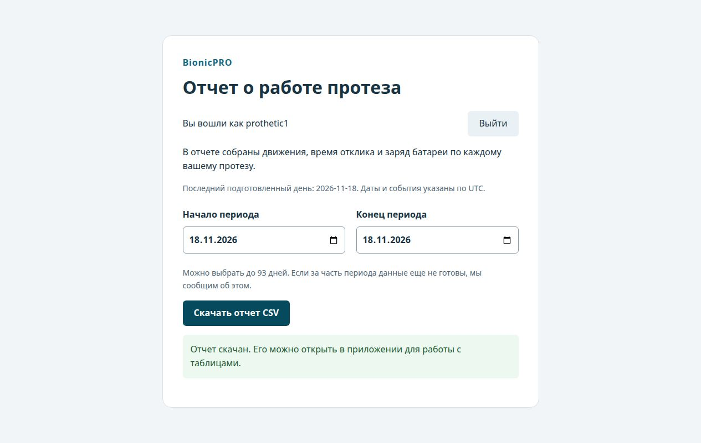

# Проверка решения

Проверка выполнена 19 ноября 2026 года на локальном Docker-стенде. Использованы только вымышленные пользователи и данные из `scripts/seed.py`.

## Сверка с заданием

| Пункт | Где выполнен | Что проверено |
| --- | --- | --- |
| 1.1. Учетные записи и региональные IdP | [Схема входа](diagrams/01-identity.drawio), [описание](architecture.md) | Отдельные региональные хранилища и Keycloak; внешние IdP связаны через OIDC/SAML. Это архитектура размещения, в стенде развернут один регион |
| 1.1. Токены IdP не передаются фронтенду | [BFF](../api/main.py), [React](../frontend/src/components/ReportPage.tsx) | Браузер получает ID сессии; access- и refresh-токены остаются на сервере |
| 1.2. PKCE | [BFF](../api/main.py), [realm](../keycloak/realm-export.json) | Реальный вход с S256; Keycloak отклоняет отсутствие challenge и неверный verifier |
| 2.1. Архитектура отчетности | [Схема отчетности](diagrams/02-reporting.drawio) | CRM и телеметрия поступают в Airflow, затем в ClickHouse; отдельный сервис вызывается через исходный API |
| 2.2. DAG, расписание и витрина | [DAG](../airflow/dags/daily_reports.py), [ETL](../airflow/pipeline/etl.py), [DDL](../infra/clickhouse/01-schema.sql) | Семь суточных запусков; объединение источников по владельцу на момент события; повтор дня без дубликатов |
| 2.3. API /reports | [Сервис отчетов](../reports_service/main.py), [публичный API](../api/main.py) | Запрос к настоящему ClickHouse, готовые показатели в JSON и CSV; при скачивании нет JOIN и агрегаций |
| 2.4. Только собственные отчеты | [Проверка JWT и роли](../common/auth.py), [сервис отчетов](../reports_service/main.py) | Анонимный запрос отклонен; два пользователя видят разные устройства; передать чужой ID нельзя |
| 2.5. Кнопка в UI | [ReportPage](../frontend/src/components/ReportPage.tsx) | Вход, выбор дня и скачивание CSV проверены в браузере |
| Только обработанный период | [Сервис отчетов](../reports_service/main.py), [тесты](../tests) | Текущий день и пропуск внутри периода дают 409; обработанный день без событий дает пустой отчет |

## Исправления после повторной проверки

- Выход больше не пытается сначала обновить истекший токен. Локальная сессия удаляется и при недоступном Keycloak; Origin и CSRF по-прежнему проверяются.
- Некорректный state с не-ASCII символами отклоняется с HTTP 400. Раньше сравнение строк могло вызвать ошибку сервера.
- Для ID-токена проверяются `azp` и тип `ID`. Проверка роли принимает только список строк, как предусмотрено форматом токена.
- ETL явно закрывает соединения с PostgreSQL после чтения.
- В README исправлена команда повторной обработки дня. `airflow dags test` выбирал предыдущий суточный интервал. Команда `airflow tasks clear` проверена на существующем запуске за 12 ноября.
- На схеме отчетности восстановлены связи пилота, приложения и чипа. Исходные компоненты и будущие интеграции отделены от реализованных частей стенда. В описании уточнены границы поддержки внешних IdP и Android.

## Сборка и запуск

- Docker Compose проверен командой `docker compose config --quiet`.
- Все образы собраны. React завершил production build без ошибок.
- Keycloak 26.5.7 импортировал realm; API, сервис отчетов, Redis, PostgreSQL, ClickHouse и Airflow запущены.
- На этой машине DNS внутри BuildKit был недоступен. Образы собраны с `docker-compose.build-host.yaml`, без изменения сети работающих контейнеров.
- Airflow не обнаружил ошибок импорта DAG. Семь запусков за 12-18 ноября завершились со статусом `success`.
- В витрине находятся семь маркеров готовности и 252 события: три протеза, семь дней, 12 событий на протез в сутки.

## Автоматические тесты

`pytest` выполнил 51 тест, все прошли. Проверка повторена на Python 3.12 в отдельном контейнере с теми же зависимостями, что у API. Есть одно предупреждение об устаревающем внутреннем API библиотеки AnyIO в Starlette TestClient; ошибок выполнения нет.

Тесты проверяют:

- действительную и поддельную подпись JWT;
- issuer, audience, срок действия, тип токена, клиента и обязательные claims;
- отказ пользователям без роли отчетности, включая администратора;
- вычисление S256 по контрольному примеру RFC 7636;
- одноразовый state и привязку callback к браузерной cookie;
- отсутствие токенов в ответах браузеру;
- обновление access- и refresh-токенов без продления абсолютного срока сессии;
- завершение сессии при отклоненном refresh и сохранение сессии при временной ошибке IdP;
- проверку Origin и CSRF при выходе;
- выход с истекшим access-токеном при недоступном Keycloak;
- отказ при некорректном state, типе ID-токена, клиенте или структуре ролей;
- фильтр владельца отчета по проверенным `iss` и `sub`;
- запрет параметров выбора другого пользователя и повторяющихся параметров;
- незагруженный период, пропуск внутри периода и пустой завершенный день;
- CSV, защиту от формул и ошибочные даты.

`ruff check` и `git diff --check` завершились без замечаний.

## ETL на PostgreSQL и ClickHouse

Запущен `tests/etl_integration.py` с настоящими БД. Проверено пять групп сценариев:

| Сценарий | Результат |
| --- | --- |
| Смена владельца в середине суток | Каждое событие отнесено к владельцу на момент записи, включая точную границу интервала |
| Повтор того же дня | Данные и счетчики не изменились, дубликаты не появились |
| Неизвестное устройство | ETL завершился ошибкой, ранее опубликованная партиция сохранилась |
| Позднее событие | Повтор дня добавил событие в итоговые показатели без удвоения предыдущих |
| Пустой день и незавершенный интервал | Для пустого завершенного дня опубликован маркер; незавершенный интервал отвергнут |

Дополнительно проверено, что учетная запись сервиса отчетов не имеет права менять витрину. Попытка записи отклонена ClickHouse с `ACCESS_DENIED`.

## Полный сценарий входа и отчетов

`scripts/smoke_test.py --wait-refresh` прошел все проверки на работающем стенде:

1. Анонимный запрос возвращает 401.
2. Keycloak отклоняет запрос авторизации без PKCE.
3. Обмен действительного кода с неверным verifier отклоняется с `invalid_grant`.
4. `prothetic1` получает BP-101 и BP-102, по 12 событий и 8 движений за день.
5. CSV скачивается, данных BP-201 в нем нет.
6. Параметры `user_id`, `subject` и `device_id` возвращают 400.
7. Текущий незавершенный день возвращает 409.
8. Через 125 секунд access-токен истекает; следующий запрос успешно выполняется после серверного refresh.
9. Выход без CSRF отклоняется. После корректного выхода отчет снова возвращает 401.
10. `prothetic2` видит только BP-201.
11. `prothetic3` получает пустой отчет за завершенный день.
12. `user1` и `admin1` получают 403 при запросе отчета.

В настоящем браузере выполнены вход, выбор доступного дня и скачивание через кнопку. Полученный файл содержит две строки: BP-101 и BP-102. Для каждого устройства средний отклик равен 66 мс, максимальный 77 мс, средний заряд 78,5%.

## Диаграммы и границы проверки

Обе новые схемы отрисованы и просмотрены. Проверены XML и ссылки между элементами draw.io. Общий файл содержит исходную схему и две страницы решения.

Не проводились нагрузочное тестирование, подключение настоящей CRM, тесты на физическом протезе или устройстве Android, проверка внешних IdP и юридическая оценка размещения данных в конкретной зарубежной стране. Эти интеграции описаны в архитектуре и не выдаются за реализованные части локального стенда.
